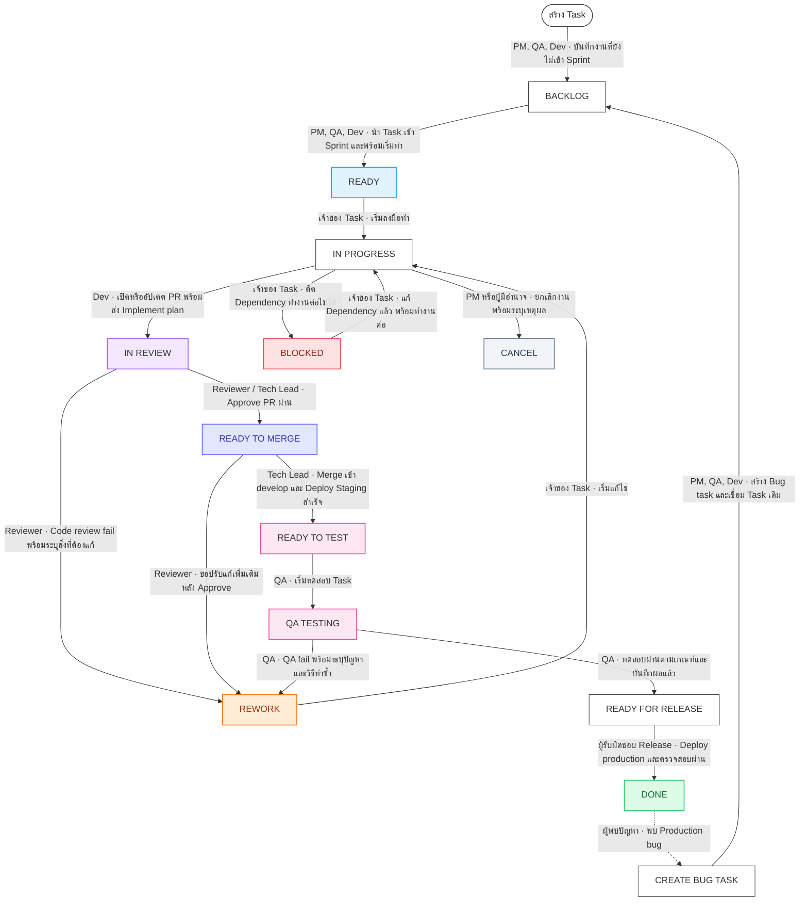

# คู่มือการพัฒนาด้วย AI Agent & ClickUp Workflow
## ThaiRun Developer & AI Agent Delivery Playbook

คู่มือนี้สำหรับนักพัฒนา (Human Dev) และ AI Coding Agents (Cursor, Claude Code, Gemini/Antigravity, Codex) ในทุกโปรเจกต์ของ ThaiRun เพื่อให้ทำงานร่วมกันได้อย่างรวดเร็ว ปลอดภัย โค้ดไม่ชนกัน และติดตามสถานะงานบน ClickUp อัตโนมัติ

---

## 1. กฎเหล็ก 6 ข้อ (Core Rules)

$$\textbf{1 Task Card } = \textbf{ 1 Branch } = \textbf{ 1 Pull Request}$$

1. **Tech Lead ต้องอนุมัติแผนก่อนเริ่มงาน (Lead Sign-off Gate):** วางแผนเสร็จต้องส่งให้ Tech Lead รีวิวและเปลี่ยนสถานะเป็น `ready` ก่อนเท่านั้น ถึงจะเริ่มลงมือเขียนโค้ดได้
2. **ห้ามรวบงาน (No Bundling):** 1 การ์ดงาน ทำ 1 กิ่ง และเปิด 1 PR เท่านั้น
   > [!IMPORTANT]
   > **ทำไมงานที่มีทั้ง API และ Web ถึงห้ามใช้การ์ดเดียวกัน? (API vs Web Separation)**
   > หากฟีเจอร์ต้องทำทั้งฝั่ง Backend (API) และ Frontend (Web/Admin) **ห้ามรวมไว้ในการ์ดเดียวเด็ดขาด** เพราะ:
   > 1. **คนละ Git Repository:** API และ Web แยกคนละ repo (เช่น `photos-api` และ `photos-web`) ไม่สามารถเปิด 1 PR ข้าม 2 repo ได้
   > 2. **CI/CD Status Race Condition:** CI/CD ของแต่ละ repo จะ trigger ซิงก์สถานะของการ์ด ClickUp เดียวกัน เช่น หาก PR ฝั่ง Web ถูก merge ก่อน CI จะย้ายการ์ดไป `testing` ทันที ทั้งที่ API ยังไม่ merge
   > 3. **Lifecycle & Rollback อิสระจากกัน:** API ต้อง deploy ขึ้นก่อนหรือรองรับ backward compatibility เพื่อให้ Web ทดสอบได้
   >
   > **แนวทางสร้างการ์ดที่ถูกต้องสำหรับ Fullstack Feature:**
   > - **แบบที่ 1 (แนะนำ - Parent Task + Subtasks):** สร้าง Parent Task (หรือ Epic) เป็นชื่อฟีเจอร์หลัก แล้วแตกเป็น 2 Subtasks แยก List ตาม repo:
   >   - Subtask 1: `[API-xxx] <Feature> Endpoint & Service` (ผูก List ของ API Repo)
   >   - Subtask 2: `[WEB-xxx] <Feature> UI Component & API Integration` (ผูก List ของ Web Repo)
   >   - ตั้ง ClickUp Dependency: กำหนดให้ Subtask Web *waiting on* Subtask API
   > - **แบบที่ 2 (Independent Cards):** สร้าง 2 การ์ดอิสระใน List ประจำ repo ของตัวเอง พร้อมระบุใน Description อ้างอิงหากัน
3. **RED ก่อน GREEN เสมอ:** ต้องเขียนเทสต์ให้พังก่อน (Phase 1 RED) ยืนยันว่าเทสต์จับ Error ทางธุรกิจได้จริง แล้วจึงเขียนโค้ดแก้ให้ผ่าน (Phase 2 GREEN)
4. **แก้เฉพาะ Owned Paths:** AI หรือ Dev ต้องแก้ไขเฉพาะไฟล์ที่กำหนดไว้ในการ์ด ห้ามแก้ไฟล์อื่นโดยไม่จำเป็น
5. **ClickUp Status อัปเดตผ่าน Git/CI:** สถานะใน ClickUp จะเปลี่ยนตามเหตุการณ์ใน Git อัตโนมัติ (Draft PR → `IN PROGRESS`, Ready for review → `IN REVIEW`, PR Approved → `READY TO MERGE`, Merged → `READY TO TEST` / `testing`)
6. **ห้าม Merge เข้ากิ่งหลักเอง:** ทุก PR เปิดเข้ากิ่งหลักของ repo (`develop` หรือ `main`) เท่านั้น การ Merge เป็นหน้าที่ของ Team Lead

---

## 2. ขั้นตอนการวางแผนและแตกงานโดย Dev (Planning & Task Decomposition)

ก่อนเริ่มเขียนโค้ด Dev ต้องวางแผนและกำหนดกรอบงาน (Scope Boundary) ให้ชัดเจน จากนั้น**บันทึกสเปกลง `Implementation/` และส่งให้ Tech Lead รีวิวก่อนเสมอ**

### 2.1 มาตรฐานการตั้งชื่อ (Naming Conventions & Identity Standards)

เพื่อให้ทั้ง Developer, Tech Lead, AI Coding Agents และระบบ Automation (GitHub Actions / Bitbucket Pipelines) ทำงานสอดประสานกันอย่างแม่นยำ ไม่สับสน ทุกชิ้นงานต้องใช้มาตรฐานการตั้งชื่อ 5 จุดดังนี้:

#### 1) การตั้งรหัส Task Card ID (`<TASK-ID>`)
- **รูปแบบ:** `<DOMAIN>-<NUMBER>` (ตัวพิมพ์ใหญ่ คั่นด้วยเครื่องหมายขีดกลาง)
- **หลักการรันเลข:** แนะนำให้รันเลขทีละ 10 (เช่น `010`, `020`, `030`) เพื่อเปิดช่องว่างไว้สำหรับการแทรกการ์ดย่อยในอนาคต (เช่น `015`)
- **Prefix ประจำโดเมนของระบบ:**
  - `AUTH-xxx`: ระบบยืนยันตัวตน, สิทธิ์ผู้ใช้, Token, OTP, Login
  - `RACE-xxx`: ระบบรับสมัคร, จัดการงานวิ่ง, ตั๋ว/BIB, เช็กอิน
  - `PHOTO-xxx`: ระบบค้นหา/แสดงรูปภาพ, แกลเลอรี, อัปโหลด, วอเตอร์มาร์ก
  - `FACE-xxx`: การประมวลผลใบหน้า, Face Grid, Face Recognition
  - `BIB-xxx`: การตรวจจับป้ายบิบ, OCR, Bib Search
  - `SHOE-xxx`: ระบบตรวจนับรองเท้า, โมเดลตรวจจับ, Pipeline
  - `PAY-xxx`: ระบบชำระเงิน, Omise, PromptPay, ใบเสร็จ/ใบกำกับภาษี
  - `INFRA-xxx`: โครงสร้างพื้นฐาน, Docker, Kubernetes, Cloudflare Worker, CI/CD
  - `CONTRACT-xxx`: Shared Types, Data Schema, Interface ข้ามเซอร์วิส

#### 2) การตั้งชื่อการ์ดบน ClickUp (ClickUp Task Name)
- **รูปแบบ:** `[<TASK-ID>] <Verb + Specific Feature / Component>`
- **ความยาว:** สั้น กระชับ ตรงประเด็น (แนะนำ 4–8 คำ) ให้รู้ทันทีว่าทำ "อะไร" ที่ "ส่วนไหน"
- **กฎเหล็ก:**
  - ต้องขึ้นต้นด้วย `[<TASK-ID>]` เสมอ
  - **ห้ามใส่รหัส ClickUp (เช่น `DEV-4346`) ลงในชื่อการ์ด** เพราะระบบ ClickUp จะใส่ Custom ID ไว้ที่หัวการ์ดให้อยู่แล้ว
- **ตารางเปรียบเทียบตัวอย่าง:**

| สถานะ | ตัวอย่างการตั้งชื่อ | คำอธิบาย |
|---|---|---|
| ✅ **ดีมาก** | `[AUTH-010] Verify OTP Service` | ชัดเจน มีรหัส Task ID บอกการกระทำและเซอร์วิส |
| ✅ **ดีมาก** | `[RACE-020] Parallelize bib counter update` | บอกชัดเจนว่าปรับปรุงประสิทธิภาพการนับ BIB |
| ✅ **ดีมาก** | `[SHOE-015] Real-time keypoints smoothing` | ระบุฟีเจอร์และเป้าหมายของงานชัดเจน |
| ❌ *ไม่ดี* | `ทำระบบล็อกอิน` | ขาด Task ID และกว้างเกินไป ไม่รู้ขอบเขตงาน |
| ❌ *ไม่ดี* | `แก้บั๊ก race condition` | ขาด Task ID ไม่ระบุโมดูลหรือไฟล์ที่เกิดปัญหา |
| ❌ *ไม่ดี* | `DEV-4346: [AUTH-010] Verify OTP` | ใส่รหัส `DEV-4346` ซ้ำซ้อนในชื่อการ์ด |

#### 3) การตั้งชื่อไฟล์สเปก (`Implementation/<feature>-spec.md`)
- **รูปแบบ:** `Implementation/<feature-name-kebab-case>-spec.md`
- **ตัวอย่าง:**
  - `Implementation/auth-otp-verification-spec.md`
  - `Implementation/real-time-smoothing-spec.md`
  - `Implementation/face-grid-and-text-grid-spec.md`

#### 4) การตั้งชื่อ Git Branch
รองรับ 2 รูปแบบตามความสะดวก (Flexible Dual-Mode):
- **แบบที่ 1: Simplified (ClickUp-First / แนะนำ):** `<type>/<CLICKUP-ID>-<short-slug>`
  - `feat/DEV-4346-verify-otp`
  - `fix/DEV-4350-bib-counter-race`
  - `refactor/DEV-4355-keypoints-smoothing`
- **แบบที่ 2: Explicit (Spec-First / ระบุคู่):** `<type>/<TASK-ID>-<CLICKUP-ID>-<short-slug>`
  - `feat/AUTH-010-DEV-4346-verify-otp`
  - `fix/RACE-020-DEV-4350-bib-counter-race`
- **ประเภทงาน (`<type>`):** `feat/`, `fix/`, `refactor/`, `chore/`, `test/`
- **เหตุผลสำคัญ:** รหัส `<CLICKUP-ID>` ในชื่อ Branch คือสิ่งที่ GitHub Actions และ Bitbucket Pipelines ใช้ตรวจจับเพื่อซิงก์สถานะงานอัตโนมัติ

#### 5) การตั้งชื่อ Pull Request & Git Trailer
- **PR Title:**
  - แบบ Simplified: `[<CLICKUP-ID>] <ชื่องาน>` (เช่น `[DEV-4346] Verify OTP Service`)
  - แบบ Explicit: `[<TASK-ID>] <ชื่องาน>` (เช่น `[AUTH-010] Verify OTP Service`)
- **PR Body บรรทัดแรกสุด:** ต้องมี Git Trailer `ClickUp-Task: <CLICKUP-ID>` เสมอ
- **Git Commit Message:** แนะนำ Conventional Commits พร้อม Trailer ที่บรรทัดสุดท้าย:
  ```text
  feat(auth): add otp verification endpoint

  ClickUp-Task: DEV-4346
  ```

---

### 2.2 โครงสร้างการ์ดงานมาตรฐาน (Task Card Schema)
ทุกชิ้นงานที่จะนำเข้าสู่ระบบ ควรมีข้อมูล 5 ส่วนหลัก:

| ส่วนประกอบ | รายละเอียดที่ต้องระบุ | ตัวอย่าง |
|---|---|---|
| **Header** | Task ID, ชื่องาน, ประเภทงาน (Type), และแต้ม (Points) | `AUTH-010`: Verify OTP Service (Feature, 3 pts) |
| **Context & Scope** | อธิบายว่าทำอะไร อินพุต/เอาต์พุตคืออะไร | เพิ่ม API รับเบอร์โทรและรหัส OTP 6 หลัก เพื่อยืนยันตัวตน |
| **Owned Paths** | **ไฟล์/โฟลเดอร์ที่อนุญาตให้สร้างหรือแก้ไขเท่านั้น** | `src/services/auth.ts`<br>`tests/auth.test.ts` |
| **Must Not Modify** | **ไฟล์ที่ห้ามแตะเด็ดขาด** (ป้องกันโค้ดชนกัน) | `packages/db/schema/*`<br>`packages/contracts/*` |
| **RED Scenarios** | เคสทดสอบล่วงหน้าที่ต้องรันแล้วพังใน Phase 1 | `RED-1`: ส่ง OTP ไม่ตรง คาดหวัง error `INVALID_OTP`<br>`RED-2`: ส่ง OTP หมดอายุ คาดหวัง error `OTP_EXPIRED` |
| **Acceptance Criteria** | เกณฑ์ตรวจรับงานที่ชัดเจน (AC) | - [ ] ผ่าน unit tests ครบทุกเคส<br>- [ ] ตรวจสอบผ่าน `pnpm typecheck` |

> [!TIP]
> **การกำหนดประเภทงาน (Types) & แต้ม (Points):**
> - **Types**: `Feature` (ความสามารถใหม่), `Bug` (แก้ข้อผิดพลาด), `Refactor` (ปรับโครงสร้างโค้ด), `Tech Debt` (ล้างหนี้ทางเทคนิค), `Spike` (งานวิจัย/ทดลอง), `Infra` (งานระบบ/CI)
> - **Points**: ใช้ Fibonacci `1, 2, 3, 5, 8` — **หากประเมินได้มากกว่า 8 แต้ม ให้แตกออกเป็นการ์ดย่อยทันที**

---

### 2.3 การสั่ง AI ช่วยวิเคราะห์และแตกงาน (Planning Prompt Template)
Dev สามารถโยน Requirement หรือ User Story ให้ AI ใน IDE ช่วยร่าง Task Cards ออกมาตามมาตรฐานได้ทันที:

```text
เรามี requirement ดังนี้:
"<ใส่ Requirement หรือ User Story ของคุณที่นี่>"

ช่วยวิเคราะห์สถาปัตยกรรม และแตกออกเป็น Task Cards ตามมาตรฐาน ThaiRun:
1. กำหนด Task ID (เช่น AUTH-001, AUTH-002) พร้อม Type และ Points (Fibonacci <= 8)
2. กำหนด Owned Paths ให้กระชับและแยกขาดกัน (Isolated Boundary)
3. ระบุ Must Not Modify เพื่อป้องกันการแก้ไฟล์ส่วนกลาง
4. ออกแบบ RED Scenarios สำหรับ TDD (อย่างน้อย 2-3 เคสต่อการ์ด)
5. กำหนด Acceptance Criteria (AC-1..N) ที่วัดผลได้จริง
```

---

### 2.4 การบันทึกสเปกลงโฟลเดอร์ `Implementation/` (Single Source of Truth)

> [!IMPORTANT]
> **ทำไมต้องเก็บใน `Implementation/` ของแต่ละโปรเจกต์?**
> - **AI อ่าน Context ไวและแม่นยำ 100%:** AI ใน IDE (Cursor, Claude Code, Antigravity) สามารถเปิดอ่านไฟล์ Markdown ในโปรเจกต์ได้ทันทีโดยตรง ไม่ต้องพึ่งพา Network ยิง API ไปถาม ClickUp
> - **Git History & Blame:** สเปกและ Task Cards ผูกติดกับ Repository ตรวจสอบย้อนหลังได้ว่าสถาปัตยกรรมถูกออกแบบเมื่อไหร่และด้วยเหตุผลอะไร
> - **แยกหน้าที่ชัดเจน:** ClickUp ทำหน้าที่เป็น **Status Tracker** (ดูภาพรวม sprint) ส่วน `Implementation/` ทำหน้าที่เป็น **Technical Truth** (เก็บ Owned Paths, AC, และ TDD Scenarios)

#### วิธีปฏิบัติ:
1. สร้างโฟลเดอร์ `Implementation/` ที่ root ของ repo (หากยังไม่มี)
2. สร้างไฟล์สเปกตามชื่อฟีเจอร์ เช่น:
   ```text
   Implementation/<feature-name>-spec.md
   ```
   *(ตัวอย่างจริง: `Implementation/auth-otp-verification-spec.md` หรือ `Implementation/rtmpose-keypoints-integration-spec.md`)*
3. นำ Task Cards ที่ออกแบบไว้ (Owned Paths, Must Not Modify, RED Scenarios, AC) บันทึกลงในไฟล์นี้

---

### 2.5 การนำการ์ดเข้าสู่ ClickUp และรายละเอียดข้อมูล (Detailed ClickUp Card)

เมื่อมีไฟล์สเปกใน `Implementation/` แล้ว ให้สร้างการ์ดใน ClickUp List ประจำโปรเจกต์ของคุณ (ดูตารางในข้อ 8) โดยอ้างอิงมาตรฐานจาก [Sprint Manual](https://app.clickup.com/90182419955/v/dc/2kzmn1fk-3258) ดังนี้:

#### 1) ข้อมูลพื้นฐานของการ์ด
- **Task Name:** `[<TASK-ID>] <ชื่องาน>` เช่น `[AUTH-010] Verify OTP Service` *(ไม่ต้องใส่ `DEV-xxxx` ซ้ำในชื่อ เพราะ ClickUp มี Custom ID ให้อยู่แล้ว)*
- **Status เริ่มต้น:** ปรับเป็น **`backlog`**
- **ตารางสถานะทั้งหมด (ClickUp Statuses):**
  | สถานะ | ความหมาย / เงื่อนไข |
  |---|---|
  | 🩶 `BACKLOG` | งานที่ยังไม่เข้า Sprint |
  | 🩵 `READY` | ผ่าน Planning และ Tech Lead อนุมัติ พร้อมทำใน Sprint |
  | 💙 `IN PROGRESS` | Dev หรือ AI Agent เริ่มทำหรือกำลังแก้ไขงาน |
  | 💜 `IN REVIEW` | เปิด PR แล้ว รอรีวิวโค้ด |
  | 🫐 `READY TO MERGE` | Code Review ผ่านและ Approve แล้ว รอคิว Merge เข้า develop |
  | 🩷 `READY TO TEST` / `TESTING` | Review ผ่าน และ Deploy ขึ้น Staging พร้อมทดสอบ |
  | 🧡 `QA TEST` | QA กำลังทดสอบ |
  | ❤️ `REWORK` | Reviewer หรือ QA ส่งกลับแก้ เมื่อเริ่มแก้จะกลับเข้า `IN PROGRESS` |
  | ❤️ `BLOCKED` | ติด Dependency ทำต่อไม่ได้ แก้แล้วกลับสถานะเดิม |
  | 💚 `READY FOR RELEASE` | QA ผ่าน รอ Deploy ขึ้น Production |
  | 💚 `DONE` | Deploy ขึ้น Production และตรวจสอบผ่านเรียบร้อย |
  | 🩶 `CANCEL` | ยกเลิกงาน ไม่ทำต่อแล้ว |

- **Sprint Points (Story Points):** ประเมินตามเกณฑ์ความซับซ้อนใน Sprint Manual
  | Point | ระดับความรู้สึก | ตัวอย่างงาน |
  |---|---|---|
  | **1 pt** | เล็กมาก | แก้ typo, ปรับ label |
  | **2 pts** | เล็ก | แก้ bug ธรรมดา, ปรับ UI เล็กน้อย |
  | **3 pts** | กลาง | เพิ่ม endpoint เล็ก, ฟังก์ชันย่อย |
  | **5 pts** | ใหญ่ | ทำ feature ย่อยที่มี logic หลายส่วน |
  | **8 pts** | ใหญ่มาก | ปรับเปลี่ยน flow ระบบหลัก |
  *(หากประเมินได้มากกว่า 8 แต้ม ให้แตกออกเป็นการ์ดย่อยทันที)*

- **Time Estimate:** ใส่เวลาประมาณการทำงานจริง (เช่น `2h`, `4h`, `1d`) ก่อนเริ่มงาน

#### 2) ข้อมูล Custom Fields ที่ต้องระบุ
- **`Type` (ประเภทงาน):** เลือกตามข้อกำหนดใน Sprint Manual
  - 🟢 `Feature`: งานใหม่ เช่น Add VOD frame jump, Add printing tracking
  - 🔴 `Bug`: งานแก้ไข เช่น Samsung VOD playback, Queue retry fail
  - 🟡 `Refactor`: งานปรับปรุงโครงสร้าง เช่น Improve worker retry logic, Cleanup upload service
  - 🟠 `Tech Debt`: งานล้างหนี้ทางเทคนิค เช่น Replace legacy API, Remove hardcoded config, Improve logging *(📌 สำคัญมากสำหรับ Infra Sprint)*
  - 🔵 `Spike`: งาน Research / PoC เช่น Test YOLOv10 accuracy, Test ffmpeg HDR support, Investigate Cloudflare timeout *(📌 ไม่ควรใส่ Story Point เยอะ)*
  - 🔥 `Hotfix`: บั๊กวิกฤตบน Production เช่น Production down, Payment fail, Printing order fail *(📌 ใช้แยกจาก Bug เพื่อวัด Sprint Interrupt)*
  - ⚙️ `Infra`: งานระบบ เช่น Deploy pipeline, CI/CD update, Pentest fix, Monitoring setup
- **`Epic` ที่ควรจัดหมวดหมู่:**
  - 🟢 `Product Features`: เปลี่ยน UI, เพิ่มหน้าเว็บ, แก้ UX, เพิ่ม flow ผู้ใช้, Login / Register, Download page
  - 🟡 `UX/UI Design`: Layout, Wireframe, Component redesign, Responsive fix, Visual improvement, Interaction change (เช่น Improve download modal layout, Revise Mango sales page, Design mobile cropper, Update typography)
  - 🟣 `Media & AI Processing`: มีการ process รูป/วิดีโอ, Worker ทำงาน, AI detect, ffmpeg, RunReel / InstantBot (เช่น Optimize frame jump, Face detection fail, Shoe detection retrain, Cropper fix)
  - 🔵 `External Integration`: คุยกับ Partner, Printing, Payment, Tracking API, Webhook (เช่น Japan shipping tracking, SFTP upload fail, Payment callback timeout)
  - 🔴 `Infrastructure`: Deploy, CI/CD, Monitoring, Pentest, Performance, Config / Env (เช่น Add retry logic, Update worker timeout, Fix CORS policy, HDR playback support)
  - 🟤 `Data & Storage`: Upload, R2 / S3, File sync, Metadata, DSLR ingest (เช่น Upload pipeline fail, R2 sync issue, Thumbnail reduce size)
- **`Repository`:** ระบุบริบทของ repo เช่น `api`, `web-admin`, `web`, `pipeline`, `mobile`
- **`PR Link`:** ใส่ URL ของ Pull Request ที่เปิดขึ้นมา หรือ merge แล้ว
- **`Start Date` & `End Date`:** ลง timestamp วันเวลาเริ่มเปิด PR และวันเวลาที่ merge เข้า develop

#### 3) แผนภาพวงจรสถานะงานและ Error Handling (Mermaid Workflow)


> 💡 **Mermaid Source Code** (สำหรับคัดลอกไปแก้ไขหรือปรับแต่ง flow):



- **กรณี Code Review ไม่ผ่าน:**
  `IN PROGRESS` ➔ `PR open` ➔ `IN REVIEW` ➔ Review Fail ➔ กลับเข้า `IN PROGRESS` แก้ไข ➔ `IN REVIEW` ใหม่
- **กรณี QA Test ไม่ผ่าน:**
  `IN REVIEW` ➔ Merge ➔ `READY TO TEST` (Staging) ➔ `QA TEST` ➔ QA Fail ➔ เข้าสู่ `REWORK` ➔ กลับเข้า `IN PROGRESS` แก้ไข ➔ เปิด PR เข้า `IN REVIEW` ➔ Merge เข้า `READY TO TEST` ใหม่ ➔ QA Pass ➔ `READY FOR RELEASE` ➔ `DONE`
- **กรณี Deploy ขึ้น Production แล้วเจอบั๊ก:**
  `DONE` ➔ เจอบั๊กบน Production ➔ สร้าง Task ประเภท `Bug` หรือ `Hotfix` แยกออกมาใหม่ ไม่เปิดการ์ดเดิม

#### 4) รายละเอียดใน Description
```markdown
- **Spec File:** `Implementation/<feature-name>-spec.md`
- **Owned Paths:**
  - `src/services/auth.ts`
  - `tests/auth.test.ts`
- **Must Not Modify:** `packages/db/*`
- **RED Scenarios & AC:** ดูรายละเอียดในไฟล์สเปก
```
เมื่อสร้างเสร็จ ระบบจะออกรหัส **ClickUp Task ID** ประจำการ์ดให้ (เช่น `DEV-4346`)

#### 5) คำสั่ง CLI ช่วยสร้างการ์ดและผูก PR Link อัตโนมัติ (ClickUp Helper CLI)

หาก Dev หรือ AI Coding Agent ต้องการสร้างการ์ดหรืออัปเดตข้อมูลบน ClickUp โดยไม่ต้องกดผ่านหน้าเว็บ สามารถเรียกใช้สคริปต์ `.agents/skills/clickup-task-automation/scripts/clickup_helper.js` ประจำ repo ได้ทันที (ต้องมี `CLICKUP_API_TOKEN` ใน Environment):

1. **สร้างการ์ดใหม่ (Create Task):**
   ```bash
   node .agents/skills/clickup-task-automation/scripts/clickup_helper.js create-task \
     --list-id "<LIST-ID>" \
     --name "[AUTH-010] Verify OTP Service" \
     --status "ready" \
     --desc "- **Spec File:** Implementation/auth-otp-verification-spec.md\n- **Owned Paths:** src/services/auth.ts" \
     --points 3
   ```
   *(หมายเหตุ: ดู `<LIST-ID>` ของแต่ละ repo ได้จากตารางข้อ 8 หรือไฟล์ `.clickup-workflow.toml`)*

2. **อัปเดต PR Link เข้าการ์ด (Set PR Link):**
   ```bash
   node .agents/skills/clickup-task-automation/scripts/clickup_helper.js set-pr-link \
     --task-id "DEV-4346" \
     --pr-url "https://github.com/Thairun/fotobots-whitelabel/pull/12"
   ```

3. **โพสต์คอมเมนต์ลงการ์ด (Post Comment):**
   ```bash
   node .agents/skills/clickup-task-automation/scripts/clickup_helper.js comment \
     --task-id "DEV-4346" \
     --comment "เปิด Draft PR เรียบร้อยแล้ว: https://github.com/..."
   ```

---

### 2.6 จุดตรวจสอบการวางแผนโดย Tech Lead (Planning Review Gate — บังคับ)

> [!IMPORTANT]
> **ห้ามเริ่มรันโค้ดทันทีหลังแตกงาน!** Dev ต้องส่งแผนให้ Tech Lead รีวิวและอนุมัติผ่าน **Comment ในการ์ด ClickUp** ก่อนทุกครั้ง เพื่อความปลอดภัยของระบบภาพรวม และรวมประวัติการตัดสินใจไว้ที่เดียว

#### วิธีส่งให้ Tech Lead รีวิว (โพสต์ใน Comment ของการ์ด ClickUp):
เมื่อสร้าง Task ในสถานะ `backlog` เรียบร้อยแล้ว ให้พิมพ์คอมเมนต์ลงในการ์ดนั้น พร้อมแท็ก `@TechLead`:

> **ตัวอย่าง Comment ในการ์ด ClickUp:**
> ```markdown
> @TechLead ขอส่งแผนงานให้รีวิวครับ
> - **สเปกไฟล์:** `Implementation/real-time-smoothing-spec.md`
> - **ขอบเขต Owned Paths:**
>   - `src/pipeline/smoothing.py`
>   - `tests/test_smoothing.py`
> - **Must Not Modify:** `src/pipeline/core/*`
> - **Points:** 3 pts
> - **RED Scenarios:**
>   1. `RED-1`: `test_smoothing_outlier_jitter` (กรองค่ากระโดดผิดปกติ)
>   2. `RED-2`: `test_smoothing_missing_keypoints` (จัดการเฟรมที่หลุดตรวจจับ)
> - **Acceptance Criteria:** Unit tests ผ่าน 100% + Lint & Typecheck ผ่าน
> ```

#### สิ่งที่ Tech Lead จะตรวจสอบ (Checklist):
- [ ] **สเปกใน `Implementation/` ครบถ้วนหรือไม่:** มี Task Cards, Owned Paths, RED Scenarios ชัดเจน
- [ ] **Owned Paths ชัดเจนหรือไม่:** ตีกรอบแคบพอหรือยัง ป้องกันโค้ดชนกับงานคนอื่น
- [ ] **Must Not Modify ปลอดภัยหรือไม่:** มีการแตะไฟล์โครงสร้างส่วนกลางหรือ Shared Contract หรือไม่
- [ ] **RED Scenarios ตรงจุดหรือไม่:** เทสต์ดักจับเงื่อนไขทางธุรกิจ ไม่ใช่แค่เช็กไวยากรณ์
- [ ] **ขนาดงานเหมาะสมหรือไม่:** ไม่เกิน 8 แต้ม หากใหญ่เกินไป Lead จะให้แตกงานย่อย

#### เมื่อ Tech Lead อนุมัติ (Sign-off):
1. Tech Lead ตอบกลับใน Thread คอมเมนต์ของการ์ด: **"Approved แผนเรียบร้อย ลุยได้"**
2. Tech Lead เปลี่ยนสถานะการ์ดใน ClickUp จาก `backlog` เป็น **`ready`**
3. **เมื่อการ์ดเป็น `ready` แล้วเท่านั้น Dev จึงจะเริ่มงานในข้อ 3 ได้**

---

## 3. คำสั่งสั้นเริ่มต้นงาน (Quick Start Command)

เมื่อการ์ดผ่านการอนุมัติเป็น **`ready`** ใน ClickUp แล้ว ให้เปิด Chat ใน IDE (Cursor, Claude Code, Gemini/Antigravity) แล้วพิมพ์คำสั่งสั้นได้ 2 รูปแบบตามความสะดวก (Flexible Dual-Mode):

### รูปแบบที่ 1: แบบสั้น (Simplified Mode - ClickUp-First / แนะนำ)
พิมพ์แค่ ClickUp Task ID ตัวเดียว:
```text
เริ่มงาน DEV-4346
```
*(หรือ `/start-task DEV-4346` / `start task DEV-4346`)*
- **การทำงานของ AI:** AI จะดึงข้อมูลจากการ์ด `DEV-4346` ใน ClickUp ทันที
  - หากชื่องานมีรหัสการ์ด เช่น `[AUTH-010]` หรือใน description มีระบุไฟล์สเปกใน `Implementation/` ระบบจะ auto-resolve ผูก `TASK-ID = AUTH-010` ให้เองอัตโนมัติ (Dev ไม่ต้องเสียเวลาพิมพ์ 2 ID)
  - หากเป็นการ์ดงานทั่วไป (Bug, Tech Debt) ที่ไม่มีไฟล์สเปก ระบบจะใช้ `DEV-4346` เป็น Task Identifier หลักตัวเดียว

### รูปแบบที่ 2: แบบระบุคู่ (Explicit Mode - Spec-First / รูปแบบเดิม)
ระบุทั้ง Task Card ID และ ClickUp Task ID:
```text
เริ่มงาน AUTH-010 DEV-4346
```
*(หรือ `/start-task AUTH-010 DEV-4346` / `start task AUTH-010 DEV-4346`)*
- **การทำงานของ AI:** ผูก `TASK-ID = AUTH-010` และ `CLICKUP-ID = DEV-4346` ทันที เหมาะสำหรับงานที่วาง Task Card ในไฟล์ Spec ไว้อย่างเข้มงวด

---

## 4. วงจรการทำงานตั้งแต่ต้นจนจบ (End-to-End Task Lifecycle)

```
[1. Dev วางแผนและแตกงานเป็น Task Cards]
                    │
                    ▼
[2. บันทึกสเปกลง Implementation/<feature-name>-spec.md]
                    │
                    ▼
[3. สร้างการ์ดใน ClickUp (สถานะ: backlog) & โพสต์คอมเมนต์ส่งแผน @TechLead]
                    │
                    ▼
┌────────────────────────────────────────────────────────┐
│ 4. Tech Lead Review Gate (ตรวจสเปก & อนุมัติใน ClickUp)   │
└───────────────────┬────────────────────────────────────┘
                    │
          ┌─────────┴─────────┐
          ▼ (ขอปรับแก้)        ▼ (อนุมัติผ่าน)
   [Dev ปรับปรุงแผน]    [Tech Lead ตอบคอมเมนต์ & ปรับสถานะเป็น "ready"]
                               │
                               ▼
            [5. Dev พิมพ์: เริ่มงาน DEV-xxxx หรือ เริ่มงาน <TASK-ID> DEV-xxxx]
                               │
                               ▼
┌────────────────────────────────────────────────────────┐
│ Phase 1: RED (AI ดำเนินการอัตโนมัติแล้วหยุดรอ)            │
│ 1. อ่านสเปกจาก Implementation/<feature>-spec.md        │
│ 2. สร้างกิ่ง: feat/<CLICKUP-ID>-<slug> (หรือแบบ dual)   │
│ 3. เขียนชุดทดสอบให้พังก่อน (Failing Tests) ตามสเปก     │
│ 4. Commit ด้วย trailer: ClickUp-Task: <CLICKUP-ID>     │
│ 5. Push ขึ้น fork และเปิด Draft PR เข้า develop         │
│    (ClickUp เปลี่ยนสถานะเป็น "in progress" ทันที)      │
│ 6. AI สรุปผล RED และหยุดรอ (STOP & WAIT)               │
└──────────────────────────────┬─────────────────────────┘
                               │
                               ▼
      [6. Dev ตรวจสอบผลว่าเทสต์พังถูกต้องตามเหตุผลจริง]
                               │
                               ▼
         [7. Dev พิมพ์สั่งต่อ: "RED ถูกต้อง ลุยต่อได้เลย"]
                               │
                               ▼
┌────────────────────────────────────────────────────────┐
│ Phase 2: GREEN & REFACTOR                              │
│ 1. เขียน Implementation ขั้นต่ำเฉพาะใน Owned Paths    │
│ 2. รันเทสต์จนผ่านทั้งหมด (GREEN)                        │
│ 3. Refactor โค้ดให้สะอาด ตรวจสอบ Lint และ Typecheck     │
│ 4. Commit, Push และเปลี่ยน Draft PR เป็น "Ready"       │
│    (ClickUp เปลี่ยนสถานะเป็น "in review" ทันที)        │
│ 5. ส่ง Task Completion Report ให้ Dev                   │
└──────────────────────────────┬─────────────────────────┘
                               │
                               ▼
      [8. Tech Lead รีวิวโค้ดและกด Approve PR]
          (ClickUp เปลี่ยนสถานะเป็น "ready to merge" - แยกคิวรอ merge ชัดเจน)
                                │
                                ▼
      [9. Tech Lead กด Merge PR เข้ากิ่ง develop]
          (ClickUp เปลี่ยนสถานะเป็น "testing" ทันที)
```

---

## 5. โครงสร้าง PR Template และ Git Trailer

ทุก PR จะต้องมีบรรทัด `ClickUp-Task: <CLICKUP-ID>` เป็นบรรทัดแรกของ Body เสมอ เพื่อให้ GitHub Actions ตรวจจับและซิงก์สถานะได้:

```markdown
ClickUp-Task: DEV-4346

## Task
AUTH-010

## Goal
เพิ่มระบบ Verify OTP สำหรับเบอร์โทรศัพท์นักวิ่ง

## Architecture References
- Implementation/auth-otp-verification-spec.md

## TDD
### RED
- test_verify_invalid_otp: AssertionError expected 400 got 200

### GREEN
- เพิ่มฟังก์ชัน validateOtp ใน AuthService

### REFACTOR
- แยก helper formatPhoneNumber

## Changes
- `src/services/auth.ts`
- `tests/auth.test.ts`
```

---

## 6. การตั้งค่าและใช้งานในแต่ละเครื่องมือ (Tooling Guide)

ทุก Repository ของ ThaiRun มีการติดตั้งชุดทักษะ AI (AI Skills) ไว้ในโฟลเดอร์ `.agents/skills/` ของ repo โดยตรง ประกอบด้วย 3 ทักษะหลัก:
- `start-task`: โปรโตคอลเริ่มงานอัตโนมัติ (ดึงการ์ด, แตก branch, ควบคุม RED -> GREEN)
- `worker-task-execution`: กฎการเขียนโค้ด TDD, ตีกรอบ Owned Paths และสรุปรายงาน PR
- `clickup-task-automation`: สคริปต์จัดการ ClickUp Task และซิงก์ข้อมูล (`clickup_helper.js`)

Dev และ AI Agent สามารถเริ่มงานได้ทันทีโดยไม่ต้องติดตั้งหรือคอนฟิก Global Skills ที่เครื่องผู้ใช้

### 6.1 สำหรับ Cursor
- โครงการมีไฟล์ `.cursorrules` และ `AGENTS.md` อยู่ที่ root ของ repo เรียบร้อยแล้ว
- เพียงเปิด Cursor ในโฟลเดอร์ของ repo แล้วเปิด Cursor Chat (Cmd+L / Ctrl+L)
- พิมพ์ `เริ่มงาน DEV-4346` หรือ `เริ่มงาน <TASK-ID> <CLICKUP-ID>` ได้ทันที Cursor จะอ่านข้อกำหนดจาก `.agents/skills/` และทำตามโปรโตคอลอัตโนมัติ

### 6.2 สำหรับ Claude Code
- โครงการมีไฟล์ `CLAUDE.md` ชี้ไปยัง `AGENTS.md`
- เปิด Terminal รัน `claude` ในโฟลเดอร์ repo
- พิมพ์ `/start-task DEV-4346` หรือ `เริ่มงาน DEV-4346`

### 6.3 สำหรับ Google Antigravity / Gemini
- Antigravity IDE จะโหลด `AGENTS.md` และสกิลใน `.agents/skills/` เข้า Context อัตโนมัติ
- พิมพ์คำสั่งในแชทเพื่อเริ่มงานได้ทันที

### 6.4 สำหรับ Codex CLI
- ทำงานผ่านไฟล์คำสั่งและ `.agents/skills/` ของ repo โดยตรง
- สามารถสั่งสร้างการ์ดและอัปเดตข้อมูลผ่าน `clickup_helper.js` ได้ทันที

---

## 7. สำหรับ Admin / Team Lead: การเปิดใช้งานใน Repo

เพื่อให้ CI/CD ซิงก์สถานะไปยัง ClickUp ได้สมบูรณ์ ต้องมีการตั้งค่า Token:

### 7.1 สำหรับ GitHub Repositories
- Secret `CLICKUP_API_TOKEN` ถูกตั้งค่าครบทุก repo ขององค์กร `Thairun` เรียบร้อยแล้ว (หรือตั้งค่าที่ GitHub Repo → **Settings** → **Secrets and variables** → **Actions**)
- ซิงก์สถานะอัตโนมัติผ่าน GitHub Actions Workflow `.github/workflows/clickup-status-sync.yml`

### 7.2 สำหรับ Bitbucket Repositories (`photos-api`, `photos-web`, `photos-web-admin`, `mangomango-web`, `races-api`, `races-web`)
- ตั้งค่า `CLICKUP_API_TOKEN` ใน Bitbucket ที่ **Repository settings** → **Repository variables** (หรือ Workspace variables)
- ซิงก์สถานะอัตโนมัติผ่าน Step ใน `bitbucket-pipelines.yml` โดยเรียกสคริปต์ `node scripts/bitbucket-clickup-sync.cjs`:
  - เมื่อเปิด/อัปเดต Pull Request (`pull-requests: '**'`): ซิงก์สถานะเป็น `in review`
  - เมื่อ Merge เข้า `develop` (หรือ `default`): ซิงก์สถานะเป็น `testing`

### 7.3 ไฟล์คอนฟิกประจำ Repo (`.clickup-workflow.toml`)
- แต่ละ repo จะมีไฟล์ `.clickup-workflow.toml` กำหนด `space_id`, `list_id`, `git_sync_owner` (`github_actions` หรือ `bitbucket_pipelines`) และสถานะของ ClickUp ประจำโปรเจกต์นั้นไว้เรียบร้อยแล้ว
- สามารถตรวจสอบความถูกต้องของคอนฟิกได้ด้วยคำสั่ง:
  ```bash
  python3 -c "import tomllib; print(tomllib.load(open('.clickup-workflow.toml','rb')))"
  ```

---

## 8. ตารางแมป ClickUp Space / List กับ Repo ทั้งหมด

| Space ใน ClickUp | List ประจำโครงการ | Repository (GitHub / Bitbucket) | Branch หลัก | คำสั่ง Verify |
|---|---|---|---|---|
| **ThaiRun Dev** (`90189696376`)<br>📁 Projects (`901812400011`) | `fotobots-whitelabel` (`1100690000004796`) | **GitHub:** `Thairun/fotobots-whitelabel`<br>*(โฟลเดอร์: `race-photo-requirement-discovery`)* | `develop` | `pnpm test` |
| **shoecount** (`1100690000000388`) | `shoecount` (`1100690000001039`) | **GitHub:** `Thairun/shoe-counting-pipeline` | `main` | `pytest` |
| | | **GitHub:** `Thairun/shoe-counting` | `main` | `pytest` |
| | | **GitHub:** `Thairun/shoe-counting-training` | `main` | `pytest` |
| | | **GitHub:** `Thairun/grouping-person` | `main` | `pytest` |
| | `labeling-tools` (`1100690000001040`) | **GitHub:** `Thairun/labeling-system` | `develop` | `pnpm test` |
| | | **GitHub:** `Thairun/labeling-system-tr` | `main` | `pnpm test` |
| **fotobots** (`1100690000000386`) | `fotobots-api` (`1100690000001036`) | **GitHub:** `Thairun/fotobots-platform` | `develop` | `pnpm test` |
| | | **GitHub:** `Thairun/fotobots-platform-monorepo` | `develop` | `pnpm test` |
| **photos** (`1100690000000389`) | `photos` (`1100690000001042`) | **Bitbucket:** `Thairun/photos-api` | `develop` | `pnpm test` |
| | | **Bitbucket:** `Thairun/photos-web` | `develop` | `pnpm test` |
| | | **Bitbucket:** `Thairun/photos-web-admin` | `develop` | `pnpm test` |
| | `mango` (`1100690000001043`) | **Bitbucket:** `Thairun/photos-api` *(โฟลเดอร์: `mangomango-api`)* | `develop` | `pnpm test` |
| | | **Bitbucket:** `Thairun/mangomango-web` | `develop` | `pnpm test` |
| | | **GitHub:** `Thairun/mangomango-mobile-uploader` | `main` | `npm test` |
| | | **GitHub:** `Thairun/MangobotMobile-InstantBot-` | `main` | `./gradlew test` |
| **others** (`1100690000000390`) | `race` (`1100690000001052`) | **Bitbucket:** `Thairun/races-api` | `develop` | `pnpm test` |
| | | **Bitbucket:** `Thairun/races-web` | `develop` | `pnpm test` |
| | `onerunner` (`1100690000001046`) | **GitHub:** `Thairun/onerunner-monorepo` | `develop` | `pnpm test` |
| | | **GitHub:** `Thairun/one_runner_app` | `develop` | `flutter test` |
| **autobots** (`1100690000000391`) | `autobots` (`1100690000001050`) | **GitHub:** `Thairun/autobots-cloudflare` | `main` | `pnpm test` |
| | | **GitHub:** `Thairun/autobots-py-extractor` | `develop` | `pytest` |
| | | **GitHub:** `Thairun/fotobots-bib-detect` | `main` | `pytest` |
| | `mobilebots` (`1100690000001051`) | **GitHub:** `Thairun/autobots-android-camera` | `main` | `./gradlew test` |
| | | **GitHub:** `Thairun/keyframe_picker_pi5` | `main` | `pytest` |

---

## 9. สถานะใน ClickUp และวงจรการทำงาน (Status Lifecycle & Automation)

อ้างอิงตามมาตรฐานสถานะขององค์กรใน [Sprint Manual](https://app.clickup.com/90182419955/v/dc/2kzmn1fk-3258):

### 9.1 ความหมายและเงื่อนไขของแต่ละสถานะ (12 สถานะ)

| สถานะ | ความหมาย / เงื่อนไข (ตาม Sprint Manual) | ผู้รับผิดชอบหลัก |
|---|---|---|
| 🩶 `BACKLOG` | งานที่ยังไม่เข้า Sprint (PM, QA, Dev บันทึกงานที่ยังไม่เข้า Sprint) | PM, QA, Dev |
| 🩵 `READY` | ผ่าน Planning พร้อมทำใน Sprint (Tech Lead ตรวจสอบและอนุมัติแผน) | **Tech Lead** *(ประตูบังคับ)* |
| 💙 `IN PROGRESS` | Dev หรือเจ้าของ Task เริ่มทำหรือแก้ไขงาน | เจ้าของ Task / Dev / AI |
| 💜 `IN REVIEW` | เปิด PR แล้ว พร้อมส่ง Implement plan รอรีวิว | Reviewer / Tech Lead |
| 🫐 `READY TO MERGE` | Code Review ผ่านและ Approve แล้ว รอคิว Merge เข้า develop | **Tech Lead** |
| 🩷 `READY TO TEST` / `TESTING` | Review ผ่าน, Merge และ Deploy ขึ้น Staging/QA สำเร็จ พร้อมทดสอบ | GitHub Actions / Bitbucket Pipelines |
| 🧡 `QA TEST` | QA กำลังทดสอบ Task หากไม่ผ่านส่งเข้า REWORK | QA / Tester |
| ❤️ `REWORK` | Reviewer หรือ QA ส่งกลับแก้ เริ่มแก้แล้วเข้า IN PROGRESS และรีวิวใหม่ | Reviewer / QA ➔ เจ้าของ Task |
| ❤️ `BLOCKED` | ติด Dependency ทำงานต่อไม่ได้ แก้ไขแล้วกลับสถานะเดิม | เจ้าของ Task / Lead |
| 💚 `READY FOR RELEASE` | QA ทดสอบผ่านตามเกณฑ์และบันทึกผลแล้ว รอ Deploy ขึ้น Production | QA / Release Owner |
| 💚 `DONE` | Deploy ขึ้น Production และตรวจสอบผ่านเรียบร้อย | ผู้รับผิดชอบ Release / Lead |
| 🩶 `CANCEL` | ยกเลิกงาน ไม่ทำต่อแล้ว พร้อมระบุเหตุผล | PM หรือผู้มีอำนาจ |

### 9.2 วงจรการเปลี่ยนสถานะอัตโนมัติผ่าน Git & CI/CD

| เหตุการณ์ (Git / CI Event) | สถานะใน ClickUp | ระบบที่ซิงก์ |
|---|---|---|
| Dev สั่งเริ่มงาน เปิด Draft PR | `IN PROGRESS` | GitHub Actions / Bitbucket Pipelines (อัตโนมัติ) |
| Dev ปรับ PR เป็น "Ready for review" | `IN REVIEW` | GitHub Actions / Bitbucket Pipelines (อัตโนมัติ) |
| Reviewer ตรวจพบปัญหา (Changes requested) | `REWORK` | GitHub Actions / Reviewer |
| Reviewer / Tech Lead กด Approve PR | `READY TO MERGE` | GitHub Actions (อัตโนมัติ) / Tech Lead (Bitbucket) |
| Lead กด Merge PR เข้ากิ่งหลัก (`develop`/`main`) และ Deploy Staging สำเร็จ | `READY TO TEST` (หรือ `testing`) | GitHub Actions / Bitbucket Pipelines (อัตโนมัติ) |
| QA เริ่มดำเนินการทดสอบบน Staging | `QA TEST` | QA / Tester มนุษย์ |
| QA ตรวจสอบไม่ผ่าน (พบ Defect) | `REWORK` ➔ กลับเข้า `IN PROGRESS` | QA / Tester มนุษย์ |
| QA ตรวจสอบผ่านตามเกณฑ์ | `READY FOR RELEASE` | QA / Tester มนุษย์ |
| Deploy ขึ้น Production และตรวจสอบผ่าน | `DONE` | Release Manager / Lead |
| ยกเลิกงาน | `CANCEL` | PM / Lead |

### 9.3 การจัดการข้อผิดพลาด (Workflow Error Loops)
- **กรณี Code Review Fail:**
  `IN PROGRESS` ➔ `PR open` ➔ `IN REVIEW` ➔ Reviewer ส่งกลับแก้ (`Code review fail`) ➔ `REWORK` ➔ เจ้าของ Task เริ่มแก้ไข เข้าสู่ `IN PROGRESS` ➔ เปิด PR เข้า `IN REVIEW` ใหม่
- **กรณี QA Test Fail:**
  `IN REVIEW` ➔ Merge ➔ `READY TO TEST` (Deploy Staging) ➔ `QA TEST` ➔ QA fail พร้อมระบุปัญหาและวิธีทำซ้ำ ➔ `REWORK` ➔ เจ้าของ Task เริ่มแก้ไข เข้าสู่ `IN PROGRESS` ➔ เปิด PR เข้า `IN REVIEW` ➔ Merge เข้า `READY TO TEST` ใหม่ ➔ QA Test ผ่าน ➔ `READY FOR RELEASE` ➔ `DONE`
- **กรณี Deploy ขึ้น Production แล้วพบ Bug:**
  `DONE` ➔ ผู้พบปัญหาพบ Production bug ➔ สร้าง Task ใหม่เป็นประเภท `Bug` หรือ `Hotfix` และเชื่อมโยง Task เดิมกลับเข้า `BACKLOG` (ไม่เปิดการ์ดเดิมซ้ำ)


